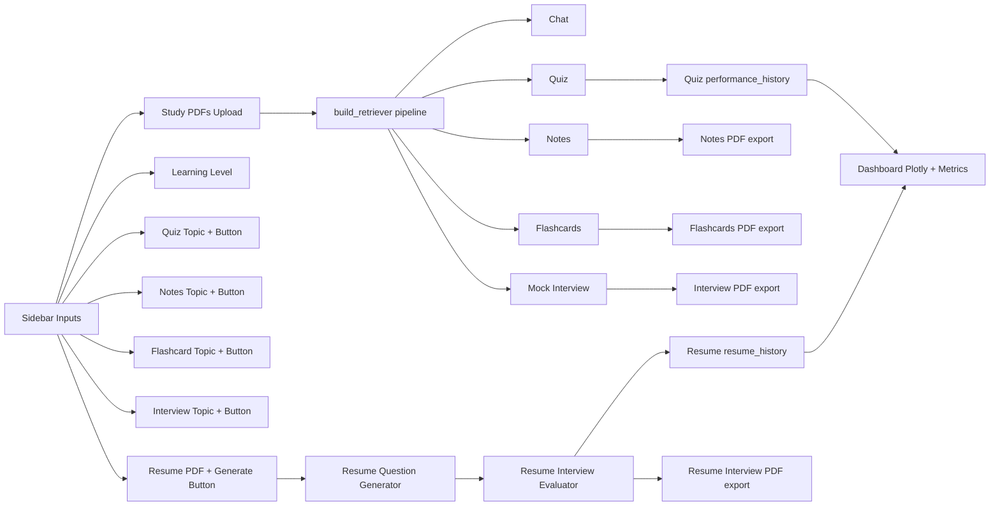

# PROJECT_WORKFLOW.md — EduGen AI Implementation Guide

## 1) Executive Summary

**EduGen AI** is a Streamlit-based learning assistant that combines:
- PDF-based Retrieval-Augmented Generation (RAG)
- AI tutoring/chat
- Quiz, notes, flashcards, mock interview, and resume interview workflows
- Progress analytics and PDF report export

### Target Users
- Students preparing from class notes/books in PDF form
- Self-learners studying technical topics
- Job candidates preparing interviews (topic-based + resume-based)
- Educators/trainers who want quick learning artifacts (quizzes/notes/flashcards)

### Problem It Solves
Learners often have scattered materials and no fast way to convert them into interactive practice. EduGen AI turns uploaded PDFs and resume content into guided Q&A, assessments, and feedback.

### Real-World Value
- Faster revision and concept clarification
- Repeated practice through quizzes/interviews
- Immediate feedback loops
- Printable/shareable outputs (PDF notes, flashcards, interview reports)

---

## 2) Elevator Pitch (Plain-English + Technical)

## Plain-English Pitch
“EduGen AI is your personal study coach. You upload your learning PDFs, ask questions, generate quizzes/notes/flashcards, and even practice interviews. It tracks your progress and gives downloadable reports so you can improve step by step.”

## Technical Explanation
EduGen AI is a Python Streamlit app using LangChain + ChromaDB + HuggingFace embeddings + Groq LLM APIs. Uploaded PDFs are loaded via `PyPDFLoader`, chunked with recursive splitting (`chunk_size=1000`, `chunk_overlap=200`), embedded using `BAAI/bge-small-en`, and stored in a local persisted Chroma vector store (`vectorstore/`). Retrieval uses MMR (`k=10`, `fetch_k=20`). Feature modules query retrieved context and prompt Groq `ChatGroq` (`model_name="openai/gpt-oss-120b"`) for chat, quiz generation, notes, flashcards, and interviews.

---

## 3) Repository Structure (Current Implementation)

## Root Files

| Path | Responsibility |
|---|---|
| `README.md` | Project overview, screenshots, setup instructions, future enhancements |
| `Dockerfile` | Container build and Streamlit runtime entrypoint |
| `requirements.txt` | Python dependencies |
| `.gitignore` | Excludes local/runtime artifacts (`vectorstore/`, `uploads/`, `exports/`, `resumes/`, etc.) |
| `.dockerignore` | Excludes local env/runtime dirs and `tests/` from Docker build context |
| `PROJECT_WORKFLOW.md` | This implementation-grounded workflow documentation |

## `frontend/`

| Path | Responsibility |
|---|---|
| `frontend/app.py` | Main Streamlit app orchestration: title, session-state initialization, sidebar handling, upload persistence, dashboard rendering, tab routing |

### `frontend/components/`

| File | Responsibility |
|---|---|
| `sidebar.py` | Collects user inputs: study PDFs, learning level, feature topics/buttons, resume PDF upload |
| `chat_ui.py` | AI tutor chat UI + message history rendering + RAG answer + source citations |
| `quiz_ui.py` | Quiz generation, answer collection, scoring, strong/weak topic extraction, recommendations, history update |
| `notes_ui.py` | Notes generation and notes PDF download |
| `flashcards_ui.py` | Flashcard generation and flashcards PDF download |
| `interview_ui.py` | Topic-based mock interview questions, answer submission, evaluation, report download |
| `resume_interview_ui.py` | Resume-based interview rounds, answer collection, score extraction, history update, report download |
| `dashboard.py` | Quiz and resume interview analytics with Pandas + Plotly + Streamlit metrics |

### `frontend/utils/`

| File | Responsibility |
|---|---|
| `rag_helper.py` | End-to-end retriever builder: `load_pdf` → `split_documents` → `get_embedding_model` → `create_vector_store` → `get_retriever` |

## `backend/`

| File | Responsibility |
|---|---|
| `pdf_loader.py` | Loads PDFs via `PyPDFLoader`; enriches metadata with `source_file` |
| `text_splitter.py` | Recursive chunking (`1000/200`) |
| `embeddings.py` | HuggingFace embedding model (`BAAI/bge-small-en`) |
| `vector_store.py` | Creates persisted Chroma vector DB in `vectorstore/` |
| `retriever.py` | Loads Chroma retriever with MMR (`k=10`, `fetch_k=20`) |
| `rag_chain.py` | Hybrid tutor logic (retrieved-context mode or general-AI fallback), response + source extraction |
| `quiz_generator.py` | LLM JSON MCQ generation (5 questions) |
| `notes_generator.py` | LLM notes generation |
| `flashcard_generator.py` | LLM JSON flashcard generation (10 cards) |
| `interview_generator.py` | LLM JSON topic-based interview question generation (5 questions) |
| `interview_evaluator.py` | LLM interview-answer evaluation with score/strengths/weaknesses/recommendations |
| `resume_interview_generator.py` | Resume PDF parsing + strict resume-grounded interview question generation (10 questions) |
| `pdf_export.py` | Notes/flashcards PDF exporters |
| `interview_report_pdf.py` | Interview/resume-interview report PDF exporter |
| `__init__.py` | Package placeholder |

## `tests/`
Contains executable scripts (mostly top-level smoke scripts, not structured unit tests); detailed review in section 15.

## `assets/`
| Path | Responsibility |
|---|---|
| `assets/architecture.png` | Architecture image used in README |
| `assets/screenshots/*.png` | UI screenshots for home/chat/quiz/notes/flashcards/interview/resume/analytics |

## `data/`
| Path | Responsibility |
|---|---|
| `data/sample.pdf` | Sample PDF used by local test scripts |

---

## 4) Full Runtime Workflow (Startup to Feature Routing)

1. **Application startup**
   - Run via `streamlit run frontend/app.py` (or Docker CMD).
   - `frontend/app.py` appends backend path into `sys.path` so frontend components can import backend modules.

2. **UI header render**
   - App title and subtitle are rendered with custom HTML markdown.

3. **Session-state initialization**
   - `app.py` initializes all app-wide keys (chat messages, quiz state, notes, flashcards, interview/resume state, analytics histories, current uploaded files).

4. **Sidebar input collection**
   - `render_sidebar()` returns a dictionary containing:
     - Study PDF uploader (multiple)
     - Learning level (`Beginner`, `Intermediate`, `Advanced`)
     - Topic inputs + buttons for quiz/notes/flashcards/interview
     - Resume PDF uploader + resume interview generation button

5. **Runtime directory creation**
   - `uploads/` and `resumes/` are created if missing (`os.makedirs(..., exist_ok=True)`).

6. **PDF upload processing**
   - Uploaded study PDFs are written to `uploads/<filename>`.
   - Saved paths are stored in `st.session_state.current_file`.

7. **Resume upload processing**
   - Uploaded resume PDF is written to `resumes/<filename>`.
   - Path stored in `st.session_state.resume_file`.

8. **Dashboard render before tabs**
   - `render_dashboard()` displays quiz/resume analytics when corresponding history exists.

9. **Tab routing**
   - App creates 6 tabs and calls:
     - `render_chat(...)`
     - `render_quiz(...)`
     - `render_notes(...)`
     - `render_flashcards(...)`
     - `render_interview(...)`
     - `render_resume_interview(...)`

---

## 5) RAG Ingestion Pipeline (Detailed)

`frontend/utils/rag_helper.py::build_retriever(pdf_paths)` connects all stages:

1. **Load PDFs** (`backend/pdf_loader.py`)
   - Uses `PyPDFLoader` per file.
   - `loader.load()` returns LangChain docs with page metadata.
   - Adds `doc.metadata["source_file"]` from filename.

2. **Chunking** (`backend/text_splitter.py`)
   - Uses `RecursiveCharacterTextSplitter` with:
     - `chunk_size=1000`
     - `chunk_overlap=200`

3. **Embeddings** (`backend/embeddings.py`)
   - Uses `HuggingFaceEmbeddings(model_name="BAAI/bge-small-en")`.

4. **Vector store persistence** (`backend/vector_store.py`)
   - Creates Chroma DB via `Chroma.from_documents(...)`.
   - `persist_directory` resolves to repository-local `vectorstore/`.

5. **Retriever creation** (`backend/retriever.py`)
   - Re-opens persisted Chroma and builds retriever:
     - `search_type="mmr"`
     - `search_kwargs={"k": 10, "fetch_k": 20}`

6. **Return retriever**
   - Used by chat/quiz/notes/flashcards/interview features.

### Mermaid — Ingestion/RAG Flow

```mermaid
flowchart TD
  A[Upload PDFs in sidebar] --> B[Save to uploads/]
  B --> C[rag_helper.build_retriever(pdf_paths)]
  C --> D[pdf_loader.load_pdf - PyPDFLoader]
  D --> E[Attach source_file metadata]
  E --> F[text_splitter.split_documents]
  F --> G[RecursiveCharacterTextSplitter 1000/200]
  G --> H[embeddings.get_embedding_model]
  H --> I[HuggingFaceEmbeddings BAAI/bge-small-en]
  I --> J[vector_store.create_vector_store]
  J --> K[Chroma persist to vectorstore/]
  K --> L[retriever.get_retriever]
  L --> M[MMR retriever k=10 fetch_k=20]
```

---

## 6) AI Tutor Chat Workflow (Detailed)

1. `render_chat(learning_level)` first replays `st.session_state.messages`.
2. User enters text through `st.chat_input`.
3. User message is appended to session history.
4. If no uploaded study PDFs exist (`current_file is None`), assistant warns and returns.
5. Else app builds retriever from uploaded PDFs using `build_retriever(...)`.
6. Chat history string is rebuilt from all prior message roles/content.
7. `create_rag_chain(retriever, chat_history, learning_level)` creates `hybrid_qa` callable.
8. `hybrid_qa(question)`:
   - Retrieves docs (`retriever.invoke(question)`)
   - If docs exist: RAG prompt includes document context
   - Else: fallback prompt uses general AI mode
   - LLM call uses `ChatGroq(model_name="openai/gpt-oss-120b")`
   - Extracts source citations from metadata: `source_file` + `page+1`
9. UI renders answer, optional source list, and appends assistant reply to session history.

### Learning Level Behavior
- **Beginner**: simple language + analogies + step-by-step
- **Intermediate**: balanced depth + gradual terminology
- **Advanced**: technical details, architecture, implementation depth

### Mermaid — Chat Flow

```mermaid
flowchart TD
  A[User asks in Chat tab] --> B{PDF uploaded?}
  B -- No --> C[Warn: upload PDF first]
  B -- Yes --> D[build_retriever]
  D --> E[create_rag_chain with chat_history + learning_level]
  E --> F[retriever.invoke(question)]
  F --> G{Retrieved docs > 0?}
  G -- Yes --> H[Prompt with document context]
  G -- No --> I[Prompt with general AI fallback]
  H --> J[ChatGroq openai/gpt-oss-120b]
  I --> J
  J --> K[Answer + source/page citations]
  K --> L[Render response + store in session_state.messages]
```

---

## 7) Quiz Workflow (Generation, Submission, Scoring, Analytics)

1. User clicks **Generate Quiz** in sidebar.
2. `render_quiz(...)` checks for uploaded PDFs; warns otherwise.
3. If topic empty, warning + `st.stop()`.
4. `build_retriever(...)` builds retriever.
5. `generate_quiz(...)`:
   - Retrieves context by topic
   - Prompts LLM to return **exactly 5 MCQs** in strict JSON
   - Parses using `json.loads`
6. Quiz saved in:
   - `latest_quiz`
   - `user_answers` reset
   - `quizzes` history with topic/content
7. UI renders each question with radio options.
8. On **Submit Quiz**:
   - Validates all questions answered
   - Computes score + percentage
   - Builds per-topic correct/wrong stats
   - Derives strong/weak topics
   - Appends `{topic, score}` to `performance_history`
   - Shows recommendations based on thresholds (>=80, >=60, else practice)
   - Expander-based answer review with explanations

---

## 8) Notes Workflow + PDF Export

1. User clicks **Generate Notes**.
2. Checks PDF upload presence.
3. Builds retriever and calls `generate_notes(retriever, topic, learning_level)`.
4. Notes text saved in `st.session_state.generated_notes` and rendered in UI.
5. `create_notes_pdf(...)`:
   - Ensures `exports/` exists
   - Writes PDF with ReportLab `SimpleDocTemplate`
   - Cleans markdown symbols (`#`, `**`) before writing paragraphs
6. Streamlit `download_button` serves generated PDF.

---

## 9) Flashcard Workflow + PDF Export

1. User clicks **Generate Flashcards**.
2. Validates uploaded PDFs and non-empty topic.
3. Builds retriever and calls `generate_flashcards(...)`.
4. LLM is prompted for **exactly 10 flashcards** JSON.
5. JSON parsed and stored in `st.session_state.flashcards`.
6. Cards shown in expanders (`Q`/`A`).
7. `create_flashcards_pdf(...)` exports all cards into ReportLab PDF in `exports/`.
8. Download button serves the PDF.

---

## 10) Topic-Based Mock Interview Workflow

1. User clicks **Start Interview**.
2. Validates uploaded PDFs + topic.
3. Builds retriever and calls `generate_interview_questions(...)` for JSON list of 5 questions.
4. Questions stored in `st.session_state.interview_questions`.
5. User answers through text areas; answers stored in `interview_answers`.
6. On submit, `evaluate_interview(questions, answers)` is called.
7. Evaluation text saved in `interview_result` and shown in UI.
8. `create_interview_report_pdf(...)` exports evaluation to `exports/interview_report.pdf`.

---

## 11) Resume Interview Workflow (Detailed)

1. User uploads resume PDF in sidebar.
2. File saved to `resumes/`; path stored in `resume_file`.
3. On **Generate Resume Questions**:
   - Requires resume upload
   - Resets prior resume answers/result
   - Calls `generate_resume_questions(resume_path, interview_round)`
   - Increments `resume_interview_round`
4. `generate_resume_questions(...)`:
   - Parses resume with `PyPDFLoader`
   - Concatenates page text
   - Prompts LLM with strict constraints:
     - only resume-mentioned technologies/topics
     - no invented skills/projects
     - round-specific style (intro/depth/scenario/advanced)
     - exactly 10 questions
5. UI cleans numbering with regex and renders question text areas.
6. On submit:
   - Questions transformed to evaluator format `[{"question": ...}]`
   - `evaluate_interview(...)` produces narrative score/feedback text
7. Score extraction:
   - Regex parses `X/10` from evaluation text
   - If found, appends `{round, score}` to `resume_history`
8. Report export:
   - Reuses `create_interview_report_pdf(..., filename="resume_interview_report.pdf")`

---

## 12) Analytics Dashboard Behavior

`frontend/components/dashboard.py` renders two analytics blocks.

### A) Quiz History Analytics (`performance_history`)
- Metrics:
  - Best Score (`max(score)`)
  - Average Score (`mean(score)`)
- Plotly line chart:
  - x: Attempt index
  - y: score (%)
  - markers enabled, custom line width/size
  - dashed threshold lines at 80 and 60
- Text history list: Attempt, topic, score

### B) Resume Interview Analytics (`resume_history`)
- Metrics:
  - Best resume score
  - Average resume score
  - Total attempts
- Plotly line chart:
  - x: round
  - y: score
- Success-style history entries per round

---

## 13) Deployment and Execution

## Local Setup
1. `python -m venv venv`
2. activate venv
3. `pip install -r requirements.txt`
4. create `.env` with `GROQ_API_KEY=...`
5. run `streamlit run frontend/app.py`

## Dockerfile Behavior
- Base image: `python:3.11-slim`
- Installs dependencies from `requirements.txt`
- Copies repository into `/app`
- Exposes `8501`
- Entrypoint command:
  - `streamlit run frontend/app.py --server.address=0.0.0.0`

## Docker Run Example
```bash
docker build -t edugen-ai .
docker run -p 8501:8501 --env-file .env edugen-ai
```

## Generated/Runtime Directories
- `uploads/` (study PDFs)
- `resumes/` (resume PDFs)
- `vectorstore/` (Chroma persistence)
- `exports/` (generated PDFs)

All are runtime/local and ignored in `.gitignore`.

---

## 14) Dependencies by Role

| Role | Important Packages |
|---|---|
| UI/App | `streamlit` |
| RAG orchestration | `langchain`, `langchain-community`, `langchain-core`, `langchain-text-splitters` |
| LLM provider integration | `langchain-groq`, `groq` |
| Vector DB | `chromadb` |
| Embeddings | `sentence-transformers`, `transformers`, `torch`, `HuggingFaceEmbeddings` usage in code |
| PDF loading/parsing | `pypdf`, `langchain_community.document_loaders.PyPDFLoader` |
| Report export | `reportlab` |
| Analytics/data processing | `pandas`, `plotly` |
| Environment config | `python-dotenv` |

Observation: `requirements.txt` includes many broader dependencies; the above are the primary runtime ones directly used in this app’s workflow.

---

## 15) Testing Assets Review (Current State)

### Important Distinction
Most files under `tests/` are **executable smoke scripts**, not structured automated tests (no `pytest` test functions/assertions).

| File | What it does now | Type | Visible Issues/Inconsistencies |
|---|---|---|---|
| `tests/test_pdf.py` | Calls `load_pdf("data/sample.pdf")`, prints first page | Smoke script | `load_pdf` expects iterable paths; string input causes per-character iteration risk |
| `tests/test_chunks.py` | Loads PDF, splits chunks, prints | Smoke script | Same path-type mismatch risk as above |
| `tests/test_vectorstore.py` | End-to-end load/split/embed/store print | Smoke script | Same path-type mismatch risk as above |
| `tests/test_retriever.py` | Builds embedding+retriever, runs query | Smoke script | Depends on existing vectorstore content; no assertions |
| `tests/test_rag.py` | Retrieval print + attempts RAG chain call | Smoke script | Uses outdated API (`create_rag_chain(retriever)` and `.invoke`) inconsistent with current function signature/return type |
| `tests/test_groq.py` | Direct LLM ping using `llama-3.3-70b-versatile` | Smoke script | Model differs from app code (`openai/gpt-oss-120b`) |
| `tests/test_resume.py` | Generates resume questions from `resumes/Resume.pdf` | Smoke script | Missing required `interview_round` arg in current function; also depends on local resume file presence |

Because this issue is documentation-only, no test-code edits were made.

---

## 16) Mermaid Feature Flow Diagram



---

## 17) Real-World Use Cases and Benefits

### Students
- Convert chapter PDFs into instant Q&A and quizzes
- Identify weak topics from quiz stats

### Self-Learners
- Generate concise notes and flashcards for spaced revision
- Use learning-level tuning to control explanation depth

### Interview Candidates
- Practice topic interviews from study material
- Practice resume-grounded interviews with score tracking across rounds

### Educators / Training Teams
- Rapidly produce quizzes and revision assets from training material
- Use analytics to monitor learner progression trends

---

## 18) Limitations and Implementation Observations (Code-Grounded)

1. **Session-state-only history**
   - Chat/quiz/interview history exists in Streamlit session memory only; no DB-backed user accounts.

2. **Local filesystem persistence**
   - Uploaded files/vectorstore/exports are local directories; not object storage.

3. **API dependency**
   - Core generation/evaluation relies on Groq API key and external LLM availability.

4. **PDF-only input**
   - Upload widgets restrict to PDF (`type=["pdf"]`).

5. **JSON parsing assumptions**
   - Quiz/flashcard/interview generators call `json.loads` directly after simple markdown fence stripping.
   - Malformed model output can break parsing.

6. **No authentication/multi-user isolation**
   - No user login, tenancy isolation, or persistent user profile handling in code.

7. **Model-name mismatch across repo artifacts**
   - App backend uses `openai/gpt-oss-120b`.
   - README and `tests/test_groq.py` reference Llama 3.3 variants.

8. **Potential repeated heavy ingestion**
   - `build_retriever(...)` is called in multiple feature handlers, recreating vector store each time.

9. **Resume round anti-repetition is prompt-only**
   - Prompt asks to avoid repeats, but prior rounds are not explicitly passed as structured memory.

10. **Score tracking depends on response format**
    - Resume analytics requires regex match of `X/10`; missing format means no score stored.

11. **No explicit file-size limits/validation beyond extension**
    - Upload handling writes file directly; no extra validation for corrupted/huge PDFs.

12. **FastAPI present in dependencies but not used in runtime path**
    - Current deployed app flow is Streamlit-only.

---

## 19) Concise Presentation Script (Demo/Interview Ready)

“EduGen AI is a Streamlit-based personalized learning assistant. A learner uploads study PDFs, and the app builds a local RAG pipeline using PyPDFLoader, recursive chunking, BAAI embeddings, and Chroma retrieval. On top of that, Groq-hosted LLM workflows power six experiences: tutor chat with citations, topic quizzes with scoring analytics, notes generation, flashcards generation, mock interviews, and resume-grounded interview rounds. The app tracks quiz and resume performance in session analytics with Plotly charts, and users can export notes, flashcards, and interview evaluations as PDFs. It’s practical for students and candidates who need fast study support and measurable progress.”

---

## 20) End-to-End Example Scenario (Student Journey)

1. Student opens app and uploads `ML_Notes.pdf` in sidebar.
2. App saves file to `uploads/` and stores its path in session state.
3. Student asks in **Chat**: “Explain overfitting simply.”
4. App builds retriever:
   - loads PDF pages,
   - chunks text (1000/200),
   - embeds with `BAAI/bge-small-en`,
   - stores/reads Chroma `vectorstore/`,
   - retrieves top MMR chunks (k=10, fetch_k=20).
5. Chat prompt is generated with learning-level guidance and retrieved context.
6. LLM returns explanation; app displays answer + source page citations.
7. Student enters topic “Overfitting” and clicks **Generate Quiz**.
8. App generates 5 MCQs as JSON, renders interactive options.
9. Student submits answers.
10. App computes score, percentage, strong/weak areas, and recommendations.
11. Performance record is appended to `performance_history`.
12. Dashboard updates with best score, average score, and attempt trend chart.
13. Student reviews wrong answers from expandable review sections.

---

## README-Only / Future-Looking Claims vs Current Code

- README includes future enhancements (e.g., multi-user auth, adaptive difficulty, voice, collaborative learning, CI/CD cloud deployment). These are **not implemented in current repository code**.
- Current implementation is a **single Streamlit app with local session + local filesystem persistence**.
